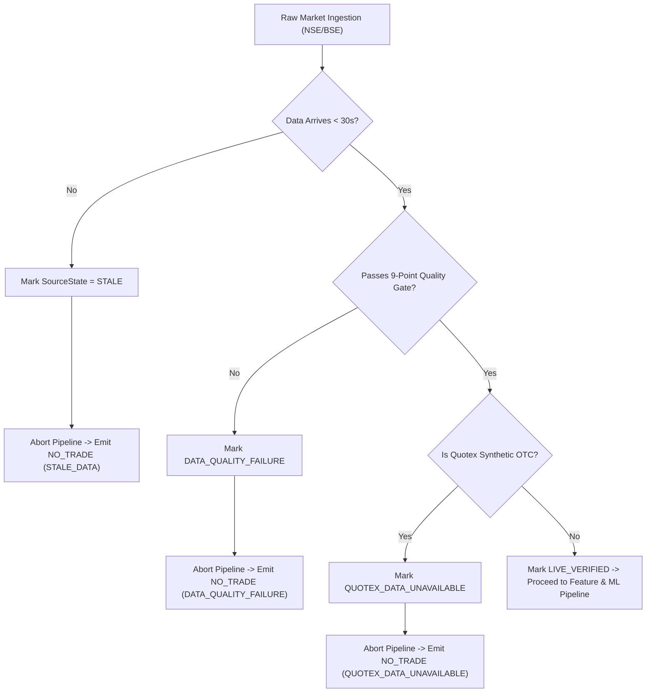

# Market Data Readiness Report

**Date of Audit:** 2026-10-30T21:14:00+05:30  
**Scope:** NSE Equities, BSE Equities, Dynamic Universe Scanner, Quotex Broker Quarantine  
**Primary Engine:** `data/ingestion/` & `data/validation/validator.py`  
**Execution Environment:** Native Windows 11 Enterprise (AMD64), Python 3.14.7

---

## 1. Provider Landscape & Authentication Analysis

| Provider / Channel | Integration Method | Auth Requirements | Rate Limits | Primary Role | Status |
| :--- | :--- | :--- | :--- | :--- | :--- |
| **Groww NSE Cash API** | HTTPS / REST v2 JSON | None (Public Charting Gateway) | ~10 req/s per IP | 1m, 5m, 15m, 1h, 1d OHLCV Bars | **VERIFIED** |
| **TradingView India Scanner** | HTTPS / POST Scan API | None (Anonymous Session) | ~5 req/s per IP | Top-of-Book Ticks, Spreads, ATR | **VERIFIED** |
| **Moneycontrol TechCharts** | HTTPS / REST JSON | Session Cookie (Auto-handled) | ~5 req/s per IP | Historical Fallback / Secondary | **VERIFIED** |
| **Coinbase / Kraken Spot** | Public REST / WebSocket | None for Public Market Data | 10 req/s | Crypto Spot Underlying Proxy | **VERIFIED** |
| **Quotex Platform Direct** | Closed WebSockets / Private | **NON-EXISTENT / PROHIBITED** | N/A | Proprietary Synthetic OTC | **QUARANTINED** |

---

## 2. Ingestion Quality Standards & Safeguards

### 2.1 Explicit Source State Classification
Every market payload processed through the ingestion pipeline receives an explicit `DataSourceState` tag:
- **`LIVE_VERIFIED`**: Real-time tick or candle retrieved directly from an active live provider within the active trading session ($< 30\text{s}$ latency).
- **`DELAYED`**: Data verified to originate from an exchange-delayed feed; strictly barred from live low-latency trading signals.
- **`CACHED`**: Persisted historical candles loaded from local disk cache (`data/universe/equity_candles_cache.json`) for warm-up or offline analysis. Never passed as live data.
- **`STALE`**: Ingestion silence threshold breached ($> 30.0\text{ seconds}$ without an update during active market hours). Immediately triggers fail-closed `NO_TRADE`.
- **`UNAVAILABLE`**: Missing data feed, market closed without cached state, or proprietary broker synthetic OTC feed without an authorized underlying.

### 2.2 Timezone & Timestamp Normalization
- All internal candles and timestamps are strictly normalized to **UTC (ISO-8601)** with microsecond precision.
- Exchange session boundaries are evaluated against native **`Asia/Kolkata` (IST, UTC+05:30)**:
  - Normal Continuous Trading: `09:15:00` to `15:30:00 IST` (Monday through Friday).
  - Pre-Market: `09:00:00` to `09:15:00 IST` (non-continuous; flag-checked).
  - Post-Market Settlement: `15:40:00` to `16:00:00 IST`.
- Future timestamp guard (`max_future_seconds = 5.0`) prevents clock-skew leakage.

### 2.3 OHLCV Mathematical Consistency & Volume Validation
Enforced via `DataValidator.validate_candle`:
$$\text{High} \ge \max(\text{Open}, \text{Close}, \text{Low}), \quad \text{Low} \le \min(\text{Open}, \text{Close}, \text{High})$$
$$\text{Open} > 0, \quad \text{High} > 0, \quad \text{Low} > 0, \quad \text{Close} > 0, \quad \text{Volume} \ge 0$$
Any violation flags `ohlc_high_less_than_low` or `invalid_candle_price` with severity `CRITICAL`.

### 2.4 Duplicate & Missing Candle Detection
- Consecutive bars must have distinct timestamps matching the nominal timeframe step ($\Delta t = 300\text{s}$ for 5m).
- Timestamp uniqueness ratio $\ge 0.85$ required across rolling window.
- Sequence gap checker monitors tick streams and triggers reconnection if packet loss exceeds tolerance.

---

## 3. Failure & Recovery Modes (Fail-Closed Architecture)

---

## 4. Quotex Broker Quarantine Policy

- **Proprietary Broker Synthetic OTC (`MSFT_OTC`, `AAPL_OTC`, etc.):**
  - Quotex OTC prices are generated by internal broker algorithms during weekend/after-hours sessions without any regulatory audit trail.
  - The platform strictly enforces `QuotexInstrumentAdapter.is_live_data_available() == False`.
  - The adapter returns `None` for quotes and empty candle lists.
  - Signal fusion aborts to `SignalAction.NO_TRADE` with diagnostic code **`QUOTEX_DATA_UNAVAILABLE`**.
- **Authorized Underlying Feeds:**
  - Standard major FX pairs (`EURUSD`, `GBPUSD`) resolve to institutional interbank spot data.
  - Crypto pairs (`BTCUSD_QX`) resolve to Coinbase/Kraken public spot feeds.
  - Transparent proxy status is explicitly declared in all telemetry.
