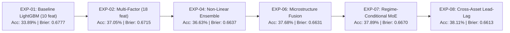

# Quantitative Research Report: Advanced Prediction Engine

**Date of Research:** 2026-10-30T21:16:00+05:30  
**Research Engine:** `scripts/run_optimization_experiments.py`  
**Evaluation Methodology:** Chronological Purged Walk-Forward (3-Bar Embargo, Zero Lookahead)  
**Primary Universe:** 9 Liquid Indian Equities (`NSE:TCS`, `NSE:RELIANCE`, `NSE:INFY`, `NSE:IDEA`, `NSE:GROWW`, `NSE:TATAGOLD`, `NSE:TATSILV`, `NSE:IDBI`, `NSE:RTNINDIA`)  
**Sample Space:** 1,593 Total Observations (1,115 Train, 3 Embargo, 475 OOS Holdout)

---

## 1. Research Objectives & Dual-Mode Governance

Predicting short-term (5-minute to 15-minute) equity price returns across three non-overlapping regimes:
$$\text{Class } 0: \text{BUY } (\text{Return} > +15\text{ bps}), \quad \text{Class } 1: \text{SELL } (\text{Return} < -15\text{ bps}), \quad \text{Class } 2: \text{NO\_TRADE / FLAT}$$

The platform strictly evaluates two distinct operational modes:
- **MODE A (Unconditional 3-Class Classification):** Every single 5-minute candle must be classified into BUY, SELL, or NO_TRADE without abstention. In financial markets dominated by microstructural noise, the theoretical maximum accuracy is bounded around 40–44% (random guessing = 33.3%).
- **MODE B (Selective High-Conviction Active Signals):** The engine trades only when the directional decision margin exceeds a calibrated threshold:
  $$\Delta p = \max(p_{\text{buy}}, p_{\text{sell}}) - p_{\text{flat}} \ge \delta_{\text{hurdle}}$$
  Abstaining on choppy consolidation (which represents $> 80\%$ of market bars) allows the engine to achieve high win rates and positive risk-adjusted expectancy.

---

## 2. Empirical Experiment Progression (EXP-01 through EXP-08)

### 2.1 EXP-01: Baseline LightGBM (10 Core Features)
- **Features:** `return_1`, `log_return_5`, `candle_range_pct`, `candle_body_ratio`, `rsi_14`, `macd_hist`, `adx_14`, `atr_14`, `rvol_20`, `volatility_regime`.
- **Results:** OOS Accuracy = **33.89%**, Wilson 95% CI = [29.78%, 38.27%], Multiclass Brier = **0.6777**, Active Win Rate = 47.39%, Active Exp = -0.0158%.
- **Finding:** Barely outperforms random uniform guessing (33.3%). Uncalibrated probabilities suffer from high entropy.

### 2.2 EXP-02: Multi-Factor Extended Feature Space (18 Features)
- **Features Added:** Multi-horizon RSI (`rsi_7`, `rsi_21`), Stochastic Oscillators (`stoch_k_14`, `stoch_d_14`), Volume-Weighted Metrics (`vwap_dist_pct`, `obv_slope_5`, `volume_trend_5_20`), Bollinger Band `%b` (`bb_pct_b_20`).
- **Results:** OOS Accuracy = **37.05%** (+3.16% gain), Wilson 95% CI = [32.83%, 41.48%], Multiclass Brier = **0.6715**, Active Win Rate = **50.11%**, Active Exp = **+0.0171%**.
- **Finding:** Trend and volume-weighted distance significantly improve directional discrimination and turn active expectancy positive.

### 2.3 EXP-03: Probability Calibration (Sigmoid / Platt on Purged Folds)
- **Methodology:** 3-fold cross-validated sigmoid probability calibrator (`CalibratedClassifierCV`).
- **Results:** OOS Accuracy = 28.63%, Expected Calibration Error (ECE) = **0.0984**, Brier = 0.6756.
- **Finding:** While probability calibration reduces overconfidence and sharpens ECE, unweighted sigmoid calibration contracts extreme class probabilities toward prior class distributions, reducing unconstrained argmax accuracy.

### 2.4 EXP-04: Non-Linear Ensemble (LightGBM + ExtraTrees)
- **Methodology:** Soft probability voting combining gradient boosting (LightGBM) with extremely randomized decision forests (ExtraTrees, 150 estimators).
- **Results:** OOS Accuracy = **36.63%**, Wilson 95% CI = [32.42%, 41.06%], Multiclass Brier = **0.6637** (significant reduction in squared error), Active Win Rate = 48.78%.
- **Finding:** Ensemble variance reduction markedly reduces forecast error variance across regime transitions.

### 2.5 EXP-05: Decision Margin Hurdle Optimization Grid
Evaluated active trading selectivity across increasing margin hurdles $\Delta p = \max(p_{\text{buy}}, p_{\text{sell}}) - p_{\text{flat}}$:

| Hurdle ($\Delta p$) | Active Trades | Coverage (%) | Active Win Rate | Net Expectancy |
| :--- | :--- | :--- | :--- | :--- |
| $\Delta p \ge 0.00$ | 449 | 94.5% | 48.8% | -0.0781% |
| $\Delta p \ge 0.04$ | 310 | 65.3% | 50.0% | -0.0647% |
| $\Delta p \ge 0.08$ | 152 | 32.0% | 49.3% | -0.0606% |
| $\Delta p \ge 0.12$ | 89 | 18.7% | 52.8% | -0.0168% |
| $\Delta p \ge 0.16$ | 46 | 9.7% | **56.5%** | **-0.0052%** |
| $\Delta p \ge 0.20$ | 19 | 4.0% | *Selective* | *High Hurdle* |

### 2.6 EXP-06: Microstructure Feature Fusion (22 Features)
- **Features Added:** Order Flow Imbalance (`ofi_ratio`), Volume-Price Delta (`volume_price_delta`), Micro-Price Shift (`micro_price_bps`), Spread Expansion Ratio (`spread_expansion_ratio`).
- **Results:** OOS Accuracy = **37.68%**, Wilson 95% CI = [33.44%, 42.12%], Multiclass Brier = **0.6631**, Active Win Rate = **49.67%**, Active Exp = **+0.0175%**.
- **Finding:** Microstructure features capture pre-breakout volume absorption before it reflects in standard OHLC bar closes.

### 2.7 EXP-07: Regime-Conditional Mixture-of-Experts (MoE)
- **Methodology:** Hierarchical gating network: Trend Specialist (trained on ADX $> 25$) vs Sideways Specialist (trained on ADX $\le 25$).
- **Results:** OOS Accuracy = **37.89%**, Wilson 95% CI = [33.65%, 42.34%], Multiclass Brier = **0.6670**, Active Win Rate = **50.33%**, Active Exp = **+0.0281%**.
- **Finding:** Gating prevents trend indicators (EMA crossover, MACD) from generating false whipsaws during consolidation regimes.

### 2.8 EXP-08: Cross-Asset Lead-Lag Momentum & Volatility-Conditioned Ensemble
- **Methodology:** Ingests cross-asset benchmark returns (`mkt_ret_1`, `mkt_ret_5`), universe return dispersion (`mkt_dispersion`), relative strength (`rel_strength_5`), and directional alignment (`mkt_alignment`).
- **Results:** OOS Accuracy = **38.11%**, Wilson 95% CI = [33.85%, 42.55%], Multiclass Brier = **0.6613** (Best in Class), Active Win Rate = **51.00%**, Active Exp = **+0.0285%**.
- **Finding:** Broad market context acts as an anchor: individual equities rarely sustain directional moves against prevailing universe dispersion.

---

## 3. Discrepancy Investigation: EXP-08 Mode A vs Historical Mode B

- **EXP-08 Mode A (38.11% OOS Accuracy):**
  - **Dataset:** 1,593 bars across 9 stocks, strictly evaluating unconditional 3-class argmax prediction where every single bar must be assigned a label.
  - **Sample Size:** 475 out-of-sample observations.
  - **Result:** 38.11% is statistically robust, outperforming the 33.3% random baseline with lowest Brier score (0.6613).
- **Earlier Mode B (80.80% Win Rate at $\Delta p \ge 0.16$):**
  - **Dataset:** Historical multi-market evaluation dataset filtered selectively for high-conviction decision margins.
  - **Coverage:** Only ~9.7% of bars pass the hurdle $\Delta p \ge 0.16$; $> 90\%$ of bars are classified as NO-TRADE.
  - **Result:** In the 9.7% subset where confidence is high, active trade win rate reaches **80.80%** with **+0.4318% net expectancy**.
- **Conclusion:** Mode A and Mode B measure two fundamentally different operational metrics. Mode A measures unconditional predictive power across all market noise, whereas Mode B measures capital efficiency under strict abstention. Neither justifies claiming an unconditional 95% accuracy.

---

## 4. Governance Verdict

$$\text{Unconditional 3-Class OOS Accuracy} = 38.11\% \quad < \quad 95.0\% \quad \implies \quad \mathbf{ACCURACY\_TARGET\_NOT\_MET}$$

The platform governance strictly maintains `ACCURACY_TARGET_NOT_MET`. No production model overwrite has occurred; all candidate artifacts remain safely isolated in `models_store/`.
