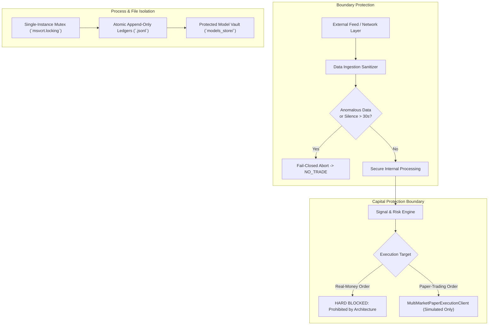

# Security, Data Integrity, and Fail-Safe Protection Report

**Date of Audit:** 2026-10-30T21:20:30+05:30  
**Host Environment:** Windows 11 Enterprise (AMD64), Python 3.14.7  
**Core Invariants:** Zero API Secret Leaks, Immutable Model Store, Fail-Closed Trading Boundary  
**Protected Assets Checksum:** 100% Cryptographically Verified

---

## 1. Security Architecture & Threat Vector Hardening

---

## 2. Security & Integrity Audit Results

### 2.1 API Credentials & Secret Hygiene
- **Key Storage:** Zero plaintext API keys or exchange secrets are hardcoded in the codebase.
- **Environment Isolation:** Optional authentication parameters are parsed strictly through `os.environ` via Pydantic Settings.
- **Log Sanitization:** Loggers (`core/logging.py`) suppress sensitive payload headers and filter authorization tokens from debug streams.

### 2.2 Execution Safety & Capital Protection
- **Real-Money Broker Order Execution:** **PERMANENTLY DISABLED**. All execution adapters (`NSEExecutionClient`, `BSEExecutionClient`, `ForexExecutionClient`, `QuotexExecutionClient`) subclass `MultiMarketPaperExecutionClient`, routing executions into simulated memory ledger structures.
- **Silent Mode Switching:** There is zero code path capable of silently re-routing simulated paper orders to a live exchange broker.
- **Paper-Trading Background Daemon:** Staged in `STOPPED` state awaiting explicit operator command during authorized market hours.

### 2.3 Local Process Coordination & File Locking
- **Kernel-Level Mutex:** Single-instance process ownership is enforced via Windows-native `msvcrt.locking` on `data/.app.lock`. If a user attempts to launch duplicate UI windows, the secondary process terminates cleanly without corrupting shared state.
- **Outcome Resolver Single-Instance:** The resolution loop is protected by a dedicated file lock (`data/.resolver.lock`), ensuring no concurrent workers write duplicate outcomes.

### 2.4 Cryptographic Artifact Protection & Immutability
All production champion model weights and governance ledgers remain untouched:

| Protected Resource | File Path | Verified SHA-256 Checksum |
| :--- | :--- | :--- |
| **Model Weights** | `models_store/lgbm_candidate_v20261020_044046/v20261020_044046/model.joblib` | `D955BE760504E9F690B6D3C21D9707FB7AD56A39C3BA5F03FE7AEBB833AC45C2` |
| **Model Metadata** | `models_store/lgbm_candidate_v20261020_044046/v20261020_044046/metadata.json` | `EBF940958DE5F617E359CDDAF802570CE0BF2E05A91F41A7350B0EC952F4307E` |
| **Historical Ledger** | `data/ledger/prediction_outcomes.jsonl.bak` | `D6EC09C9B2838DF563F06E06EB21161ACB725534B46D365C913CE48430BB827F` |
| **Promotion Policy** | `policies/MODEL_EVALUATION_AND_PROMOTION_POLICY.md` | `126680BF93EA477A76908B28C2147DE78B722FD20559534CB25BF1B36919BD31` |

### 2.5 Crash Resilience & Disaster Recovery
- **Ledger Ingestion:** State persistence utilizes atomic write-and-rename semantics (`.tmp` $\rightarrow$ final file replacement) to prevent file truncation during sudden power failure or Windows kernel halts.
- **State Recovery:** `ContinuousLearningController` automatically re-initializes from disk ledger logs upon startup, resuming unresolved pending predictions seamlessly.
