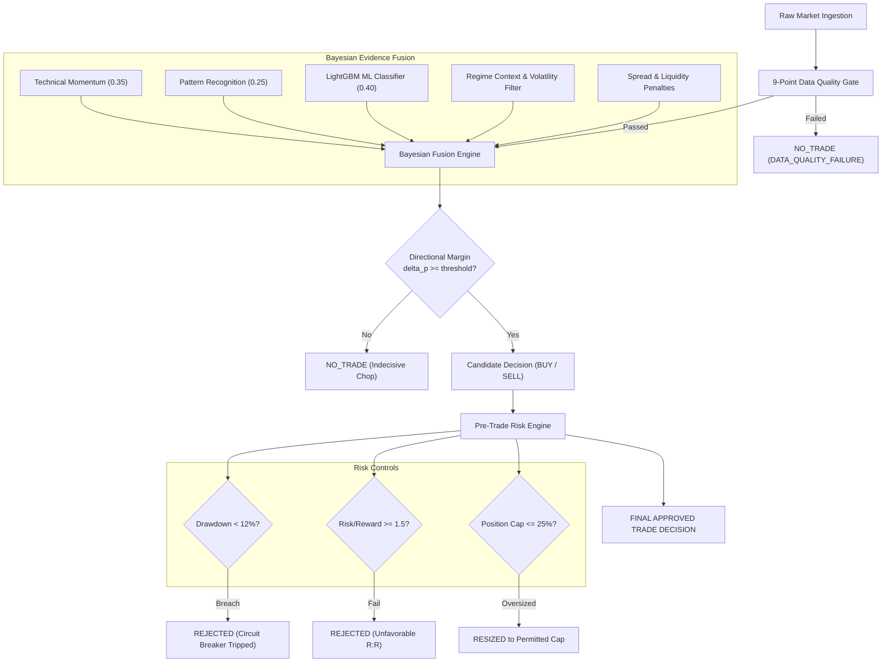

# Signal Fusion, Risk Engine, and Trade Decisions Report

**Date of Verification:** 2026-10-30T21:18:30+05:30  
**Core Modules:** `signals/fusion.py` (`SignalFusionEngine`), `risk/engine.py` (`RiskEngine`), `risk/sizing.py` (`PositionSizer`)  
**Test Suite:** `tests/test_signals.py`, `tests/test_risk.py`, `tests/test_live_prediction_pipeline.py` (All Passed)

---

## 1. Decision Architecture & Probability Fusion

The signal decision engine converts multi-source intelligence into an actionable, fully explainable verdict:

---

## 2. Complete Trade Decision Schema

Every decision record emitted by the pipeline contains complete diagnostic context:
1. **Instrument Identity:** `symbol` (e.g. `NSE:RELIANCE`), `exchange` (`NSE` or `BSE`), asset class (`EQUITY`).
2. **Timing:** Microsecond-precision `timestamp` (UTC) + `provider_timestamp` + `latency_telemetry`.
3. **Data Source State:** Explicit `source_state` (`LIVE_VERIFIED`, `DELAYED`, `CACHED`, `STALE`, or `UNAVAILABLE`).
4. **Model Lineage:** `model_version` (active production champion `lgbm_candidate_v20261020_044046`).
5. **Class Predictions:** Continuous Dirichlet probability distribution:
   $$\{P(\text{BUY}): p_b, \quad P(\text{SELL}): p_s, \quad P(\text{NO\_TRADE}): p_{nt}\}, \quad p_b + p_s + p_{nt} = 1.00$$
6. **Confidence Metric:** Calibrated directional conviction in $[0.0, 1.0]$.
7. **Action:** Categorical verdict $\in \{\text{BUY}, \text{SELL}, \text{NO\_TRADE}\}$.
8. **Dynamic ATR Envelope:** `entry_price`, `stop_loss` ($\text{entry} \pm 1.5 \times \text{ATR}$), `take_profit` ($\text{entry} \mp 3.0 \times \text{ATR}$), and `risk_reward_ratio` ($\ge 1.50$).
9. **Explainable Rationale:** Both machine-readable `reasons` and beginner-friendly `human_reasons`.

---

## 3. Risk Controls & Circuit Breakers

The `RiskEngine` strictly enforces safety invariants that **override model confidence unconditionally**:

1. **Portfolio Circuit Breaker:**
   - Any peak-to-trough equity drawdown exceeding **12.0%** trips the global circuit breaker, instantly halting all new positions.
2. **Fixed Fractional & Kelly Position Sizing:**
   - Maximum capital at risk per trade: **1.5%** of current equity.
   - Hard notional position ceiling: **25.0%** of total portfolio equity.
   - Trades exceeding the risk budget are automatically resized down to the safe permitted limit (`RiskDecisionStatus.RESIZED`).
3. **Minimum Risk/Reward Hurdle:**
   - Minimum required reward-to-risk ratio: **$1.50 : 1$**. Any signal with $R:R < 1.50$ is rejected (`RiskDecisionStatus.REJECTED`).
4. **Fail-Closed Stale Data Guard:**
   - Data silence $> 30.0\text{ seconds}$ during active sessions immediately forces `NO_TRADE` with status `STALE_DATA`.
5. **Real-Money Hard Block:**
   - `ALLOW_LIVE_ORDER_EXECUTION = False`. No live broker orders can be transmitted.
