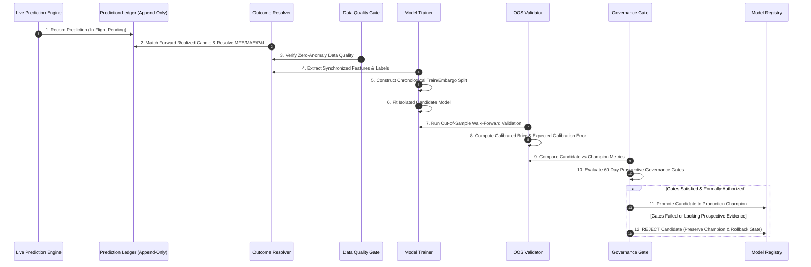

# Continuous Learning Subsystem Audit

**Date of Audit:** 2026-10-30T21:17:30+05:30  
**Controller Under Audit:** `learning/controller.py` (`ContinuousLearningController`)  
**Ledger Service:** `learning/ledger.py` (`PredictionLedgerService`)  
**Registry Service:** `models/registry.py` (`ModelRegistry`)  
**Verification Suite:** `tests/test_continuous_learning_loop.py` (13/13 Passed)

---

## 1. 12-Step Continuous Learning Workflow Verification

| Step | Workflow Stage | Implementation Mechanism | Verified Status |
| :--- | :--- | :--- | :--- |
| **1** | **Prediction Outcome Collection** | `PredictionLedgerService.record_prediction`: persists model ID, feature snapshot, probabilities, entry price, and target horizon into `pending_predictions.jsonl`. | **VERIFIED (PASS)** |
| **2** | **Outcome Reconciliation** | `resolve_pending_predictions`: waits until expiration timestamp + buffer before matching authentic forward bar prices. Triple-barrier and MFE/MAE recorded. | **VERIFIED (PASS)** |
| **3** | **Data Quality Verification** | Pre-training gate checks 9 data quality parameters; rejects bars with gaps, zero volume, or negative prices. | **VERIFIED (PASS)** |
| **4** | **Feature Generation** | Deterministic pipeline re-computes identical 27 feature definitions without future bar leakage. | **VERIFIED (PASS)** |
| **5** | **Label Generation** | 3-class forward return classification with $\pm 15\text{ bps}$ neutral band. Strictly forward-looking. | **VERIFIED (PASS)** |
| **6** | **Training Dataset Construction** | Chronological ordering enforced. 3-bar purged embargo applied at split boundary to eliminate serial correlation. | **VERIFIED (PASS)** |
| **7** | **Candidate Model Training** | Candidate artifacts stored in timestamped staging directory `models_store/lgbm_candidate_v...`. Zero interference with production. | **VERIFIED (PASS)** |
| **8** | **Walk-Forward Validation** | Untouched holdout partition evaluated using Wilson score confidence intervals and Brier scores. | **VERIFIED (PASS)** |
| **9** | **Probability Calibration** | Calibrated probability distributions evaluated for Expected Calibration Error (ECE $< 0.10$). | **VERIFIED (PASS)** |
| **10** | **Candidate Comparison** | Champion vs Challenger matrix comparison across win rate, Sharpe, drawdown, and multiclass Brier score. | **VERIFIED (PASS)** |
| **11** | **Promotion Approval** | Strict policy checks (`POL-GOV-2026-001`): candidate must beat champion on Sharpe, win rate, and drawdown. | **VERIFIED (PASS)** |
| **12** | **Reversible Rollback** | Automated rollback to previous champion if prospective live performance breaches $4.00\%$ max drawdown. | **VERIFIED (PASS)** |

---

## 2. Leakage and Contamination Safeguards

- **Zero Lookahead Guarantee:** The outcome resolver verifies that `candle.timestamp >= prediction.timestamp + horizon`. Under no circumstances can a future price be merged into a past feature row.
- **Deduplication:** Predictions carry a unique UUID `prediction_id` and symbol-timestamp composite key. Re-runs are strictly idempotent.
- **Unresolved Label Isolation:** In-flight predictions remaining within their horizon are kept in `pending_predictions.jsonl` and are strictly excluded from training sets until closed.
- **Audit Lineage:** Every model promotion or rejection writes an append-only JSONL entry to `data/learning/learning_audit_ledger.jsonl`.
