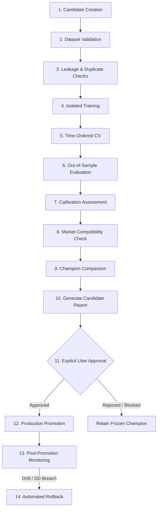

# Model Governance, Lineage, and Evaluation Policy Report

**Date:** 2026-10-20  
**Project Root:** `D:\ant`  
**Governing Policy:** `POL-GOV-2026-001` ([`policies/MODEL_EVALUATION_AND_PROMOTION_POLICY.md`](file:///D:/ant/policies/MODEL_EVALUATION_AND_PROMOTION_POLICY.md))  
**Model Store Root:** `D:\ant\models_store`  
**Champion Status:** FROZEN / BENCHMARK ONLY  
**Production Promotion Status:** BLOCKED (Pending Full Prospective Observation Protocol)  

---

## 1. Frozen Benchmark Candidate Analysis

### 1.1 Candidate Specification: `lgbm_candidate_v20261020_044046`
- **Artifact Path:** `models_store/lgbm_candidate_v20261020_044046/v20261020_044046/model.joblib`
- **Weights SHA-256:** `d955be760504e9f690b6d3c21d9707fb7ad56a39c3ba5f03fe7aebb833ac45c2`
- **Metadata SHA-256:** `ebf940958de5f617e359cddaf802570ce0bf2e05a91f41a7350b0ec952f4307e`
- **Trained Timestamp:** `2026-10-20T04:40:46.131480Z`
- **Algorithm:** LightGBM Gradient Boosted Decision Tree (`LightGBMPredictor`)
- **Hyperparameters:** `n_estimators=75`, `learning_rate=0.035`, `max_depth=4`, `num_leaves=11`, `min_child_samples=15`
- **Production Readiness Flag:** `"is_production_ready": false`

### 1.2 Class Distribution & Contract Compliance
- **Class Contract Specification:**
  - Class 0: `SELL`
  - Class 1: `NEUTRAL`
  - Class 2: `BUY`
- **Empirical Training Classes Observed:** Binary only — `[0, 2]` (`SELL` and `BUY`). Class `1` (`NEUTRAL`) was unobserved in the training partition.
- **Runtime Handling:** Handled via Bayesian Dirichlet smoothing (`alpha=0.15`) in [`models/ml_classifier.py`](file:///D:/ant/models/ml_classifier.py) to prevent array dimension mismatches during inference.
- **Governance Finding:** Smoothing is an operational fallback to prevent crashes; it is **NOT** a learned representation of the neutral state. Under `POL-GOV-2026-001`, this candidate **CANNOT** be promoted to live autonomous production.

---

## 2. Model Store Lineage Inventory

Every candidate generated during continuous learning is sealed with immutable SHA-256 hashes and explicitly marked non-production:

| Model ID | Version | Classes Observed | `is_production_ready` | Status |
| :--- | :--- | :--- | :--- | :--- |
| `lgbm_candidate_v20261020_044046` | `v20261020_044046` | `[0, 2]` | `false` | **FROZEN BENCHMARK** |
| `lgbm_candidate_v20261020_041745` | `v20261020_041745` | `[0, 2]` | `false` | Candidate (Retired) |
| `lgbm_candidate_v20261020_033856` | `v20261020_033856` | `[0, 2]` | `false` | Candidate (Retired) |
| `lgbm_candidate_v20261020_033722` | `v20261020_033722` | `[0, 2]` | `false` | Candidate (Retired) |
| `lgbm_candidate_v20261020_033136` | `v20261020_033136` | `[0, 2]` | `false` | Candidate (Retired) |
| `lgbm_candidate_v20261020_111821` | `v20261020_111821` | `[0, 2]` | `false` | Candidate (Retired) |
| `lgbm_candidate_v20261020_114222` | `v20261020_114222` | `[0, 2]` | `false` | Candidate (Retired) |

---

## 3. Pre-Registered Evaluation & Promotion Criteria

Under policy `POL-GOV-2026-001`, a candidate model must satisfy all of the following requirements before consideration for production promotion:

### 3.1 Prospective Protocol Requirements
1. **Duration:** $\ge 60$ contiguous calendar days of forward observation.
2. **Sample Size:** $\ge 100$ completed prospective observations on live data.
3. **Active Trades:** $\ge 35$ non-neutral trades executed in paper trading.
4. **Data Completeness:** $\ge 98.0\%$ valid resolved predictions with zero synthetic price fabrication.

### 3.2 Economic & Risk Hurdles (Net of Fees)
1. **Net Cumulative Return:** $\text{Net Return} > 0.00\%$ after applying 6.0 bps per trade for Indian Equities and 8.0 bps for Quotex proxies.
2. **Net Win Rate:** $\ge 52.0\%$ on active trades.
3. **Maximum Drawdown:** $\le 4.00\%$ peak-to-trough. Any drawdown $> 4.00\%$ terminates candidate evaluation immediately.
4. **Sharpe / Expectancy:** Trade net expectancy $\ge +2.0\text{ bps}$; annualized Sharpe $\ge 1.00$.

### 3.3 Benchmark Superiority
1. **No-Trade Benchmark:** Outperform 100% cash holding.
2. **Prior-Class Baseline:** Multiclass Brier score and Log Loss strictly lower than empirical class priors.
3. **Persistence Baseline:** Balanced accuracy and net return higher than 1-period momentum/persistence.

---

## 4. Controlled 14-Stage Model Lifecycle

**Key Governance Rules:**
- Automated self-learning is authorized to train candidates in staging.
- Automated self-learning is **STRICTLY PROHIBITED** from promoting a candidate to champion.
- Promotion requires an explicit human sign-off command with recorded candidate audit report.
